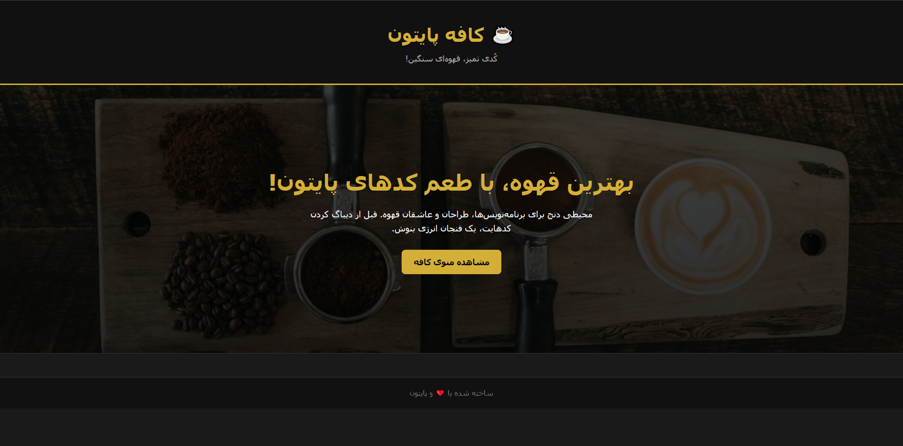
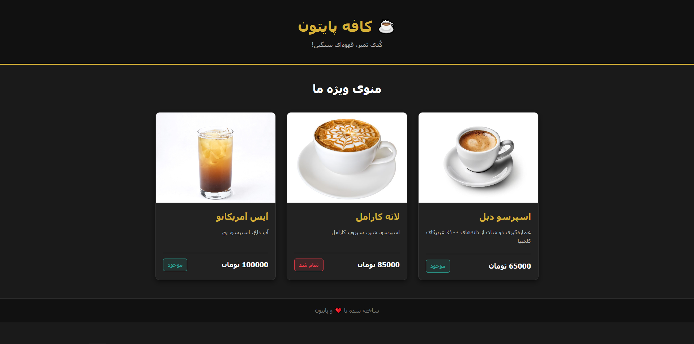
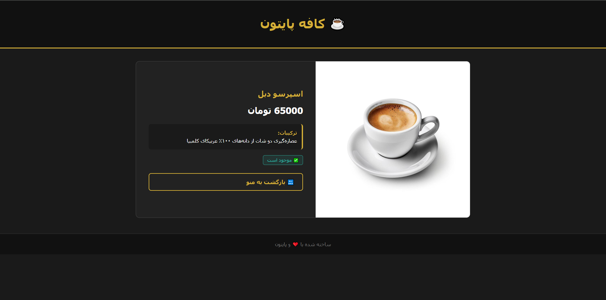
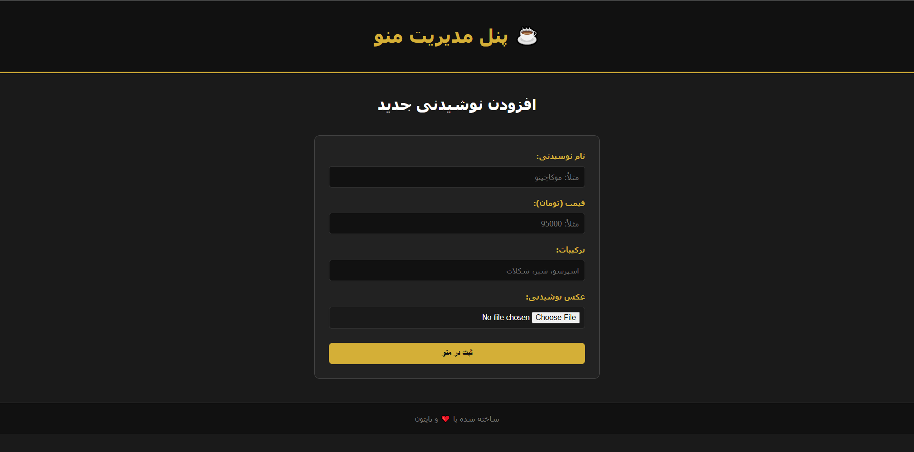

# ☕ Cafe Python | کافه پایتون

> A clean, dynamic, and fully functional menu management system built with Django. Where clean code meets heavy coffee!

## 📸 Glimpse of the Cafe

## 🚀 Core Features
- **Dynamic Menu System:** Fully categorized drinks with real-time availability badges (Available / Out of Stock).
- **Detailed Product Pages:** Ingredients, pricing, and dynamic media handling for every single item.
- **MVT Architecture:** Clean separation of logic, database, and user interface.
- **Scalable Structure:** Built ready for future REST API and Docker integration.

## 🛠️ Tech Stack
- **Backend:** Python, Django
- **Database:** SQLite (Development phase)
- **Frontend UI:** HTML5, CSS3

## ⚙️ How to Run Locally

1. Clone this repository:
   `git clone https://github.com/dev-mehrab-io/cafe-python.git`

2. Create and activate a virtual environment:
   `python -m venv venv`
   *(On Windows use: `venv\Scripts\activate` | On Mac/Linux use: `source venv/bin/activate`)*

3. Install dependencies:
   `pip install -r requirements.txt`

4. Run the development server:
   `python manage.py runserver`
   
---

💡 Credits: The backend logic and architecture were developed manually, while the Frontend UI was proudly designed and styled with the assistance of Google Gemini.